<p align="center">
  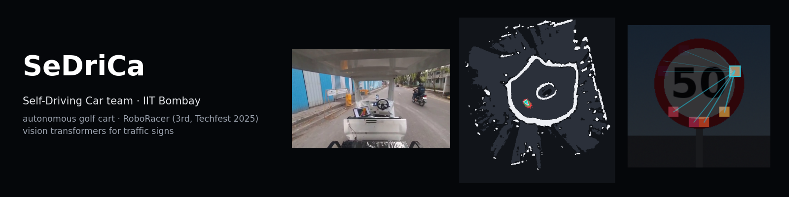
</p>

<p align="center">
  
  
  
  
  
</p>

> **TL;DR.** My work in **SeDriCa**, IIT Bombay's self-driving car team, at three scales:
> - a **full-size autonomous golf cart** driving on campus;
> - a **1/10-scale race car** that finished **3rd at the 26th International RoboRacer Autonomous Racing Competition** (Techfest 2025, IIT Bombay). Its stack is Cartographer mapping, particle-filter localisation and an adaptive pure-pursuit racing controller, with a mux that hands over to follow-the-gap for obstacle avoidance;
> - a **Vision Transformer** written from the paper for traffic-sign recognition.

---

## 1 · SeDriCa

**SeDriCa** (Self-Driving Car) is IIT Bombay's student team building autonomous vehicles end to end: sensors and drive-by-wire, mapping and localisation, planning and control, and perception. The same ideas run at two scales. On a **golf cart** they handle real campus roads; on a **1/10-scale F1TENTH / RoboRacer car** they are pushed to racing speed.

## 2 · The autonomous golf cart

<p align="center">
  <a href="docs/media/golf_cart_autonomous_drive.mp4">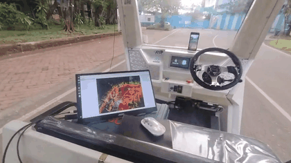</a>
  <br><sub>The cart driving itself on campus. The laptop shows the live 3-D LiDAR map. <b><a href="docs/media/golf_cart_autonomous_drive.mp4">▶ full video (55 s)</a></b></sub>
</p>

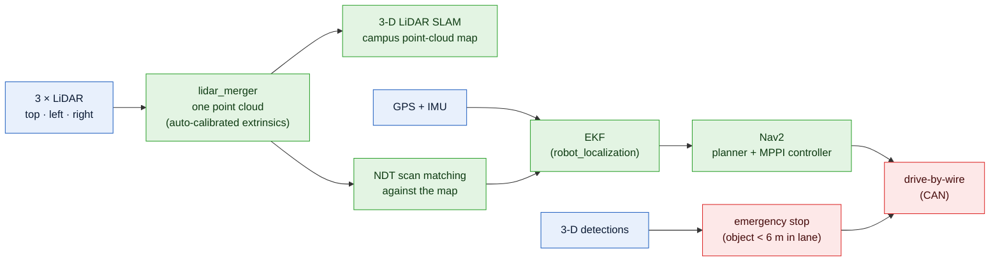

- **Seeing all around:** three LiDARs are fused into one cloud. [`lidar_merger`](golf_cart/mapping/lidar_merger) transforms each into the top sensor's frame using extrinsics from automatic LiDAR-to-LiDAR calibration ([`lidar_extrinsics/`](golf_cart/mapping/lidar_extrinsics)).
- **Knowing where it is:** a point-cloud map of the campus is built once with LiDAR SLAM ([`campus_map/`](golf_cart/mapping/campus_map): `map.pcd` + pose graph). Live scans are then matched against it with NDT, and the result is fused with GPS and IMU in an EKF.
- **Driving:** Nav2 plans the route and an **MPPI** controller tracks it ([`car_navigation/config`](golf_cart/navigation/car_navigation/config)). The stack was first brought up in the CARLA simulator through a Nav2 → CARLA adapter.
- **Safety and perception:** [`detection`](golf_cart/perception/detection) stops the cart if any detected object is closer than 6 m inside a 1 m-wide corridor ahead. A **YOLOv8 road-segmentation** model ([`road_segmentation/`](golf_cart/perception/road_segmentation)) was trained on about 8,000 road images and tested on highways and village roads.

## 3 · RoboRacer: autonomous racing

<p align="center">
  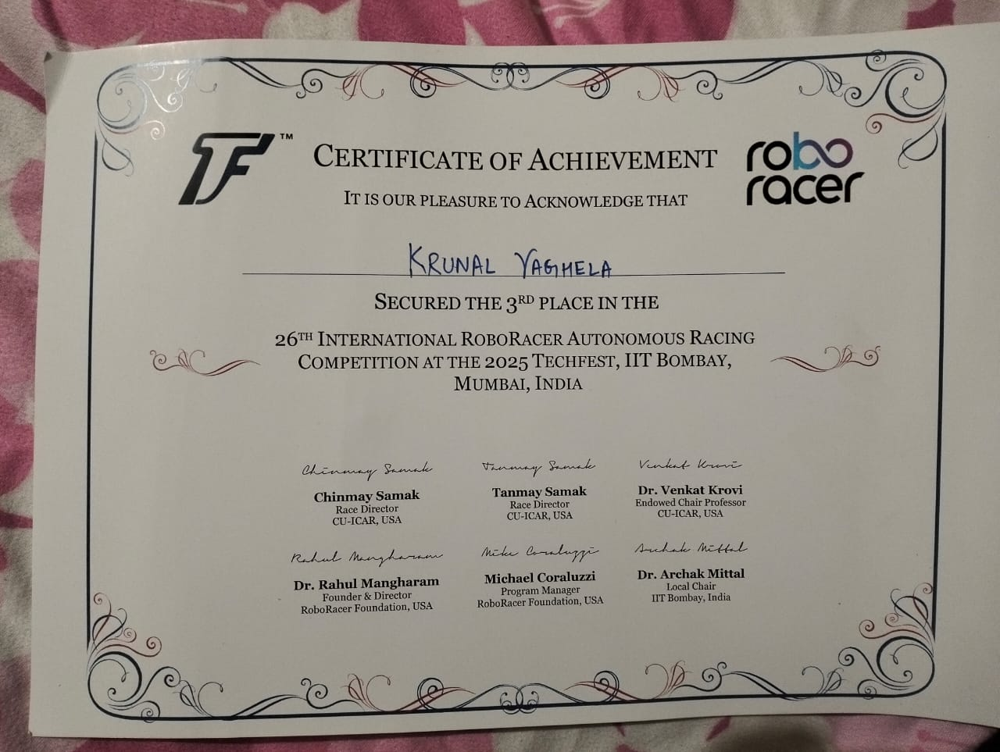
  <br><sub><b>3rd place</b>, 26th International RoboRacer Autonomous Racing Competition, Techfest 2025, IIT Bombay.</sub>
</p>

<table>
<tr>
<td width="33%">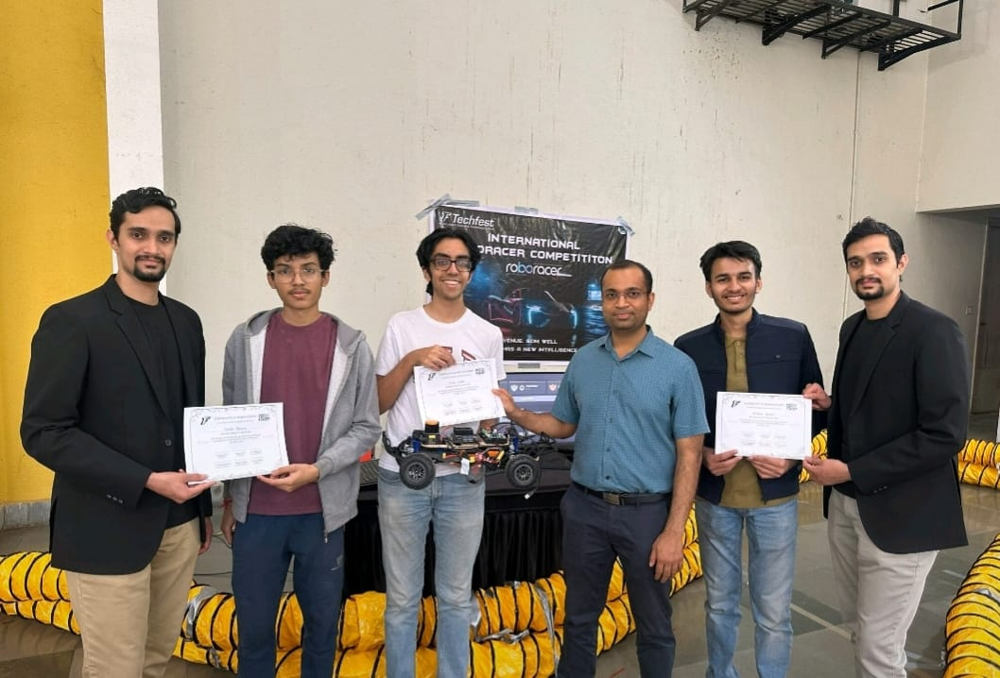<br><sub>The team with our car at the venue</sub></td>
<td width="33%">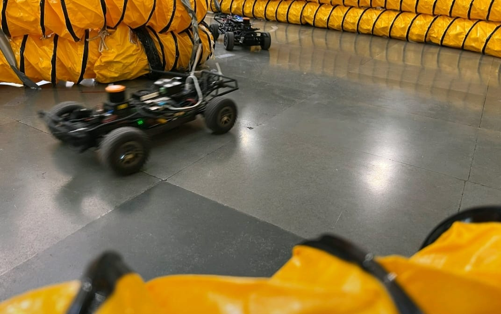<br><sub>Racing on the track</sub></td>
<td width="33%">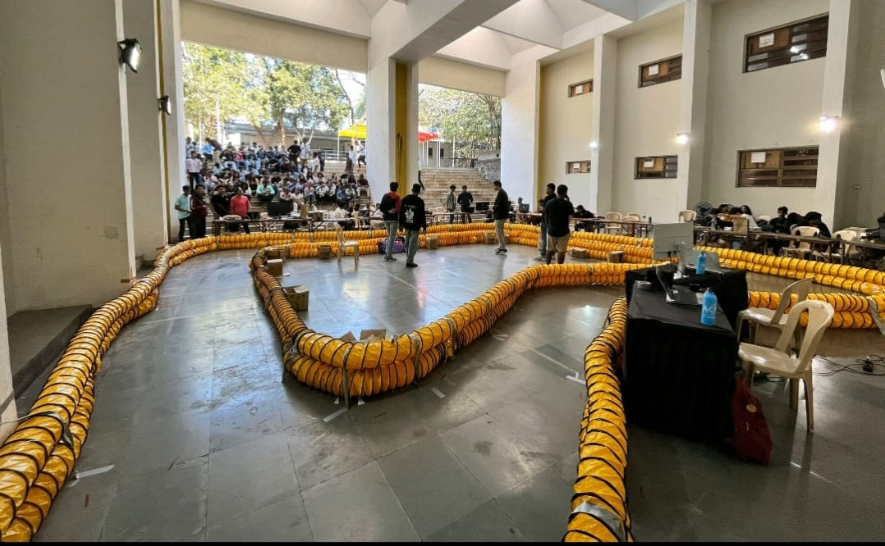<br><sub>The competition track</sub></td>
</tr>
</table>

RoboRacer (formerly F1TENTH) races 1/10-scale cars that must drive fully autonomously with only on-board sensing: a 2-D LiDAR, wheel odometry and an IMU. Our stack:

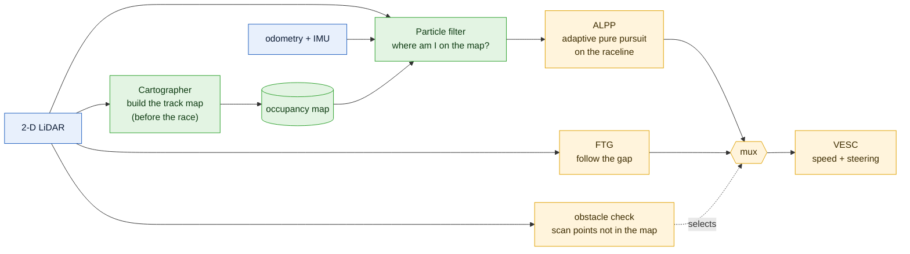

The three animations below run on **our actual competition map** ([`roboracer/maps/competition_track.pgm`](roboracer/maps), 1.2 cm per pixel). The car and its LiDAR are simulated, and each algorithm follows our code and parameters.

### Mapping with Cartographer

Before racing, the car is driven around the track once while Cartographer builds a 2-D occupancy grid. Every LiDAR beam marks the cells it passes through as free and its end point as a wall. Scan by scan, the track appears:

<p align="center">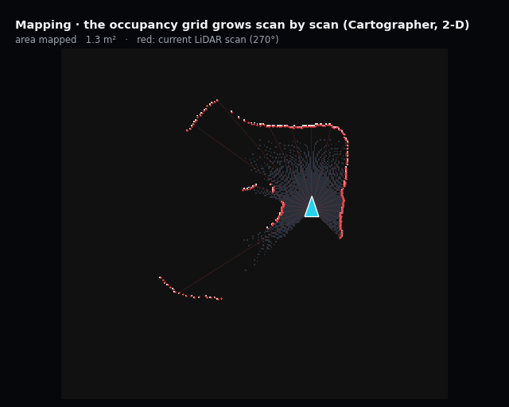</p>

Our Cartographer setups for mapping with LiDAR alone, LiDAR + IMU, and localisation in a saved map are in [`roboracer/mapping/cartographer`](roboracer/mapping/cartographer).

### Localisation with a particle filter

During the race the car must keep track of where it is on that map, many times per second. A **particle filter** keeps thousands of guesses (particles) of the car's pose:
1. **predict:** move every particle by the odometry, with noise;
2. **weight:** project the real LiDAR scan from each particle's pose. A particle scores high if the beam end-points land on walls of the map (a *likelihood field*);
3. **resample:** keep the likely particles and drop the unlikely ones.

Started with no idea where the car is, the red particles cover the whole map, split into a few competing clusters wherever the track looks alike, then lock onto the car:

<p align="center">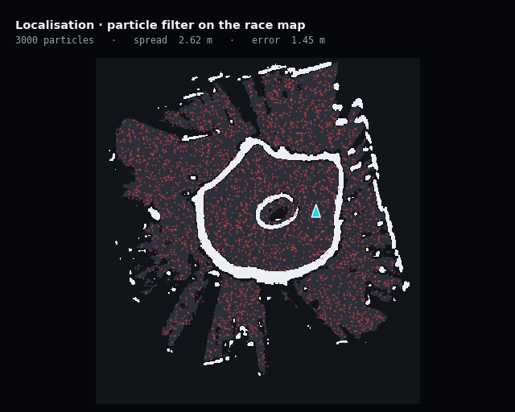</p>

### Racing with adaptive pure pursuit (ALPP), and follow-the-gap when something is in the way

**ALPP** ([`roboracer/controller/adaptive_pure_pursuit.py`](roboracer/controller/adaptive_pure_pursuit.py)) chases a point on the raceline a *look-ahead* distance ahead of the car:
- **steering:** δ = atan(2L·sin α / L_d), where α is the angle to the goal point and L = 0.33 m is the wheelbase;
- **look-ahead:** grows with speed along a sigmoid, so the car aims further ahead on straights and tighter in corners;
- **speed:** a blend β·v_curv + (1−β)·v_dev of a curvature-limited speed and a speed that drops when the car has drifted off the line. The weight β adapts online.

The **mux** passes ALPP's commands to the motors until the LiDAR sees **points that are not in the map**: an obstacle on the racing line. It then switches to **follow-the-gap (FTG)**:
1. put a "bubble" around the closest point;
2. find the widest stretch of free space in the scan;
3. steer into it.

Once the way is clear, the mux hands back to ALPP and the car rejoins the line:

<p align="center">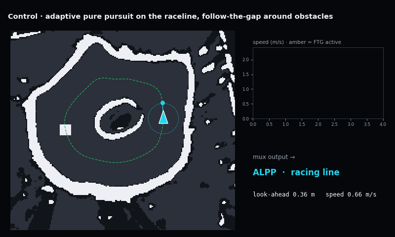</p>

## 4 · Vision Transformer for traffic signs

A self-driving car has to read traffic signs. I implemented the **Vision Transformer** from *An Image is Worth 16×16 Words* (Dosovitskiy et al., ICLR 2021) in PyTorch, written module by module from the paper's equations ([`vision_transformer/`](vision_transformer)), and used it for traffic-sign classification (43 classes, GTSRB format).

**From pixels to tokens.** A Transformer reads a sequence of "words", so the image is turned into one:

<p align="center">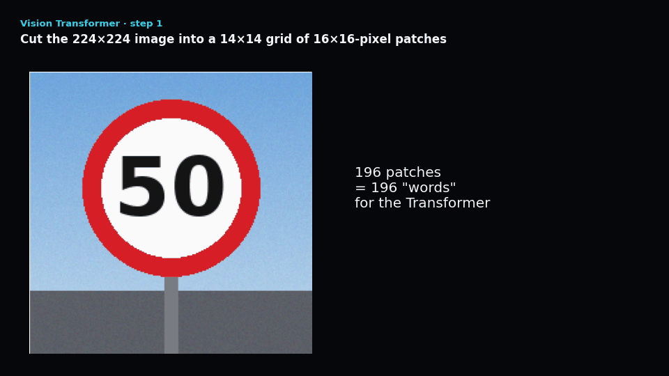</p>

**Attention between patches.** In every layer, each patch compares itself with every other patch (query · key), turns the scores into weights with a softmax, and takes a weighted mix of their values. Different heads learn different habits. Some attend **locally**, to neighbouring patches, much like a convolution. Others attend **globally**, to patches anywhere in the image with related content, such as all the pieces of a sign's red ring. Here, the highlighted patch is the query and brightness is its attention to each patch:

<p align="center">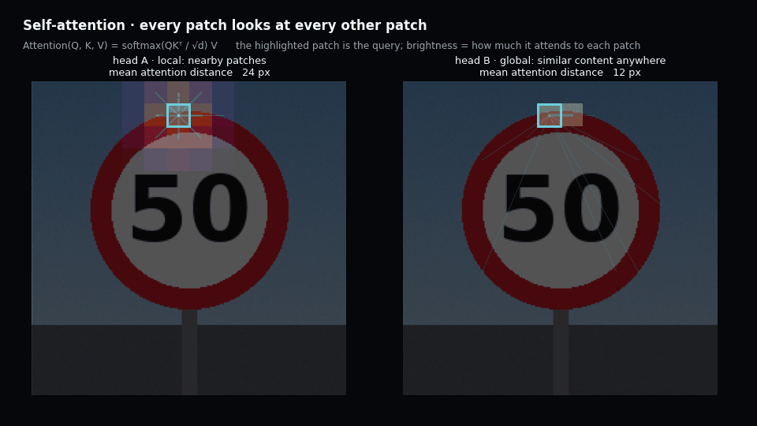</p>

<sub>The attention weights in this animation are illustrative: they are built from patch colour, texture and distance to show the two behaviours. A trained ViT learns its own query and key projections. <code>predict.py</code> draws the real attention of a trained model with attention rollout.</sub>

| Paper | Code ([`vit/model.py`](vision_transformer/vit/model.py)) |
|---|---|
| (1) z₀ = [x_class ; x_p¹E ; … ; x_pᴺE] + E_pos | `PatchEmbedding` (Conv2d, kernel = stride = 16), `cls_token`, `pos_embed` |
| (2) z′ = MSA(LN(z)) + z | `EncoderBlock`, attention half; `MultiHeadSelfAttention` written by hand, returns its weights |
| (3) z = MLP(LN(z′)) + z′ | `EncoderBlock`, MLP half (GELU) |
| (4) y = LN(z_L⁰) | final `LayerNorm` on the class token → linear head |
| ViT-Base: L = 12, D = 768, 12 heads, MLP 3072 | `vit_base()`: **85.8 M parameters** (paper: 86 M) |

```bash
cd vision_transformer
python -m vit.model                 # shape check: ViT-Base/16 and ViT-Tiny/8
python train.py                     # ViT-Tiny/8 on 64×64 GTSRB traffic signs (AdamW, warm-up + cosine, label smoothing)
python predict.py checkpoints/vit_best.pt sign.png   # top-3 classes + attention-rollout map
```

---

## Repository

```
golf_cart/            the team's packages for the autonomous golf cart (ROS 2)
roboracer/            race-car controller, particle filter, Cartographer configs and the competition map
vision_transformer/   ViT written from the paper: model, data pipeline, training, prediction
docs/                 photos, video, figures and the scripts that make the animations
```

<details open>
<summary><b>What every folder holds</b></summary>

| Folder | What it is |
|---|---|
| `golf_cart/mapping/lidar_merger` | C++ node fusing the three LiDARs into one point cloud |
| `golf_cart/mapping/lidar_extrinsics`, `campus_map` | LiDAR-to-LiDAR calibration results; campus point-cloud map and pose graph |
| `golf_cart/mapping/bag_to_pcd.py` | export point clouds from a rosbag |
| `golf_cart/navigation/car_navigation` | Nav2 configuration (MPPI controller, costmaps), behaviour tree, launch files, LiDAR-to-scan and CARLA adapters |
| `golf_cart/navigation/vehicle_iitb` | 2-D map of the test area for Nav2 |
| `golf_cart/perception/detection` | emergency-stop node on 3-D detections |
| `golf_cart/perception/road_segmentation` | YOLOv8 road-segmentation model (`best.pt`) and its training notebook |
| `roboracer/controller` | `adaptive_pure_pursuit.py` (ALPP), and a simulator raceline |
| `roboracer/localization/particle_filter` | particle filter (based on the open-source JMU ROS 2 particle filter, MIT licence) and its configs |
| `roboracer/mapping/cartographer` | Cartographer configs and launch files: scan-only mapping, scan + IMU, localisation |
| `roboracer/maps` | the competition track map |
| `vision_transformer/` | `vit/model.py`, `vit/data.py`, `train.py`, `predict.py` |
| `docs/` | `make_figures.py` + `track_sim.py` (RoboRacer animations), `vit_figures.py` (ViT animations), `media_figures.py` (banner, video preview) |

</details>

> [!NOTE]
> Third-party building blocks are used as published and are not copied here: Cartographer, Nav2, robot_localization, the LiDAR SLAM and NDT packages, the Ouster/Velodyne drivers, and the vehicle's drive-by-wire interface.

## Acknowledgements

SeDriCa, IIT Bombay. RoboRacer Foundation and Techfest IIT Bombay for the competition. ViT: A. Dosovitskiy et al., *An Image is Worth 16×16 Words: Transformers for Image Recognition at Scale*, ICLR 2021. Attention rollout: S. Abnar and W. Zuidema, ACL 2020.
